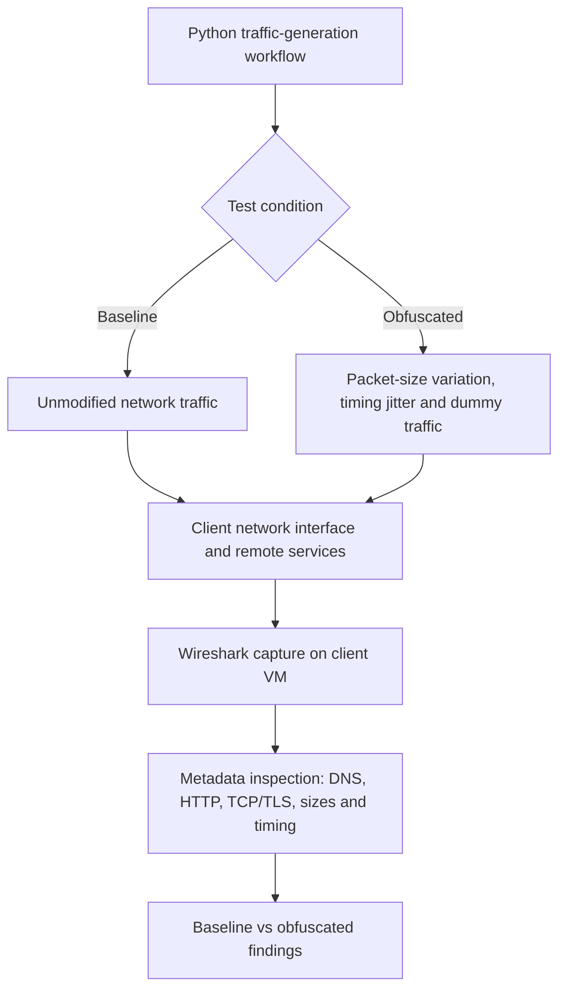
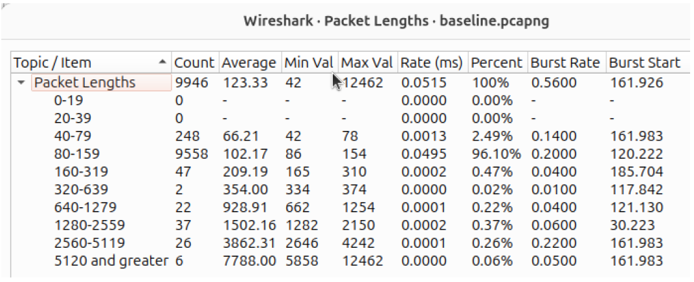
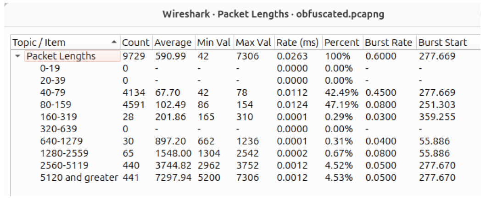
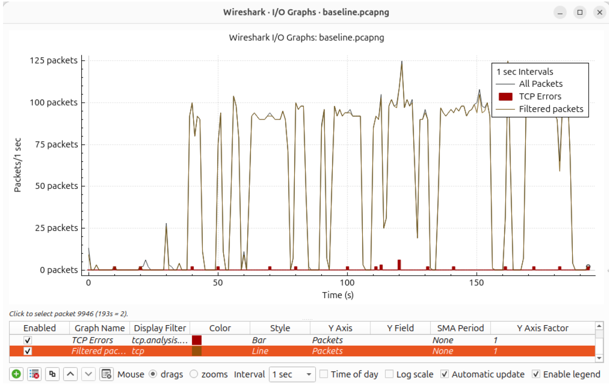
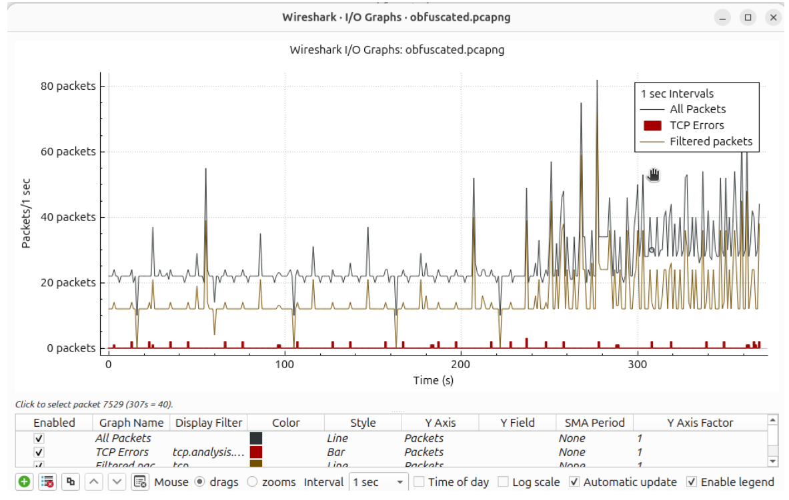

# Network Traffic Obfuscation: Security Evaluation for Defence-Oriented Environments

**Applied network security research | Wireshark · Python · Encrypted traffic analysis · Network metadata**

**Research status:** Completed experimental case study (2026)  
**Environment:** Controlled, virtualised network testbed — **not** a live defence or military network

## Executive summary

**The problem:** Encryption protects the contents of communications, but network observers can still learn from packet sizes, timings and protocol behaviour. In sensitive environments, this metadata can reveal patterns of activity even when the payload is unreadable.

**What I investigated:** Whether lightweight traffic obfuscation — packet-size modification, transmission delays/jitter and dummy traffic — makes network activity harder to characterise without breaking ordinary communications.

**What I found:** Obfuscated captures displayed more variable packet sizes and transmission timing, while DNS resolution, HTTP requests/responses and TCP/TLS communication continued functioning. However, the underlying protocols remained recognisable. **Reduced predictability is not the same as proven resistance to advanced traffic analysis.**

**Defence relevance:** The result highlights a security-design trade-off for monitored, high-assurance networks: behavioural masking may complicate passive inspection, but should not be treated as a standalone confidentiality or anti-fingerprinting control.

> **Scope clarification:** This was an independent, controlled research project informed by defence-oriented threat models. It was **not commissioned by a defence organisation**, conducted on military systems, or validated against an operational military monitoring platform.

## What I delivered

| Workstream | Evidence |
| --- | --- |
| Network experimentation | Generated baseline and modified network traffic under controlled conditions |
| Traffic analysis | Compared DNS, HTTP, TCP/TLS, packet lengths and Wireshark I/O graphs |
| Python automation | Used Python for traffic generation/modification and supporting comparative analysis |
| Security evaluation | Compared observable metadata before and after obfuscation and tested communication continuity |
| Engineering judgement | Documented trade-offs, methodological constraints and implications for high-assurance network design |

## Experimental architecture

*Architecture is a conceptual summary of the documented experimental workflow, not a diagram of a deployed defence network.*

## Selected experimental evidence

### Packet-size distribution

| Baseline capture | Obfuscated capture |
| --- | --- |
|  |  |

In the recorded samples, **96.10% of baseline packets** fell in the 80–159 byte band, compared with **47.19% in the obfuscated capture**. The obfuscated capture also showed many more packets in the 40–79 byte band. This demonstrates a changed observed size distribution, **not** a measured decrease in attacker classification accuracy.

### Traffic timing

| Baseline I/O graph | Obfuscated I/O graph |
| --- | --- |
|  |  |

The baseline showed relatively structured traffic bursts; the modified capture showed greater timing variability. The recordings differ in duration and traffic composition, so these figures are **comparative observations**, not controlled proof of any particular detection-rate improvement.

## Findings at a glance

| Network feature | Observed difference | Security interpretation |
| --- | --- | --- |
| DNS | More variable query activity | Name-resolution behaviour remained identifiable |
| HTTP | Less uniform timing and frequency | Standard request/response patterns persisted |
| TCP/TLS | Less regular transmission behaviour | Encrypted-session characteristics remained observable |
| Packet lengths | Distribution changed between captures | A source of fingerprinting information changed, but was not concealed |
| Traffic timing | I/O graph showed less consistent bursts | Behavioural masking was partial rather than comprehensive |

## Technical conclusion

Lightweight obfuscation changed observable network metadata while preserving ordinary communications in this lab. **It did not establish that a sophisticated analyst or classifier could no longer identify the traffic.** For sensitive systems, an engineering assessment should test adversary capability, operational overhead and protocol visibility together rather than assuming that additional network noise provides security.

## Limitations and evidence boundaries

- Client-side Wireshark capture limited visibility compared with network TAP/SPAN or distributed monitoring.
- The simulated workload was narrower than a production enterprise or defence network.
- No complete machine-learning classifier, detection-rate benchmark or measured false-positive study was implemented; related methods were discussed in the literature review.
- This repository currently contains a research presentation and selected figures, **not** the original Python scripts or PCAP datasets. Do not interpret the case study as a reproducible code release.
- Packet distributions and I/O graphs describe the **observed samples**; they do not alone establish causation or operational effectiveness.

## Full technical analysis

Read the [technical research report](research/TECHNICAL_REPORT.md) for the threat model, method, evidence, findings, limitations and engineering recommendations.

## Research Provenance

This professional case study is adapted from my 2026 final-year research project, *Evaluating the Effectiveness of Traffic Obfuscation Techniques Against Traffic Analysis Attacks in Defence-Oriented Network Environments*, undertaken as part of my BSc (Hons) Cyber Security degree at the **University of West London (UWL)**.

The research investigated network traffic obfuscation and metadata analysis within a controlled, simulated defence-oriented environment. No operational defence-network access is claimed.

The underlying experiments were conducted within a controlled, simulated environment. No operational defence-network access is claimed.

### Research Evidence and Reproducibility

The Wireshark figures presented in this repository are derived from the original experimental research.

Raw packet captures (PCAPs) and experimental scripts are not included in this public release. Any future publication of these materials would be subject to security review and appropriate sanitisation.

The findings should not be interpreted as validation within operational defence networks.
