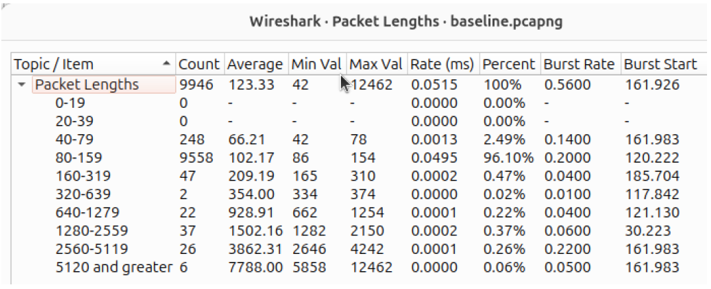
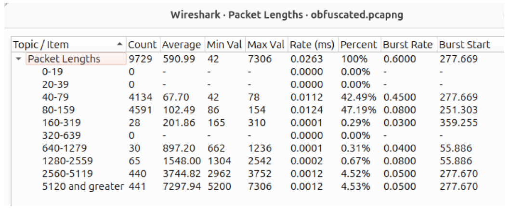
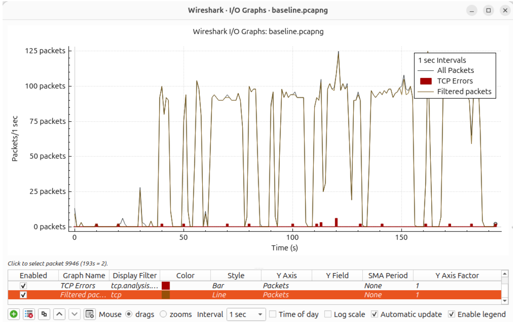
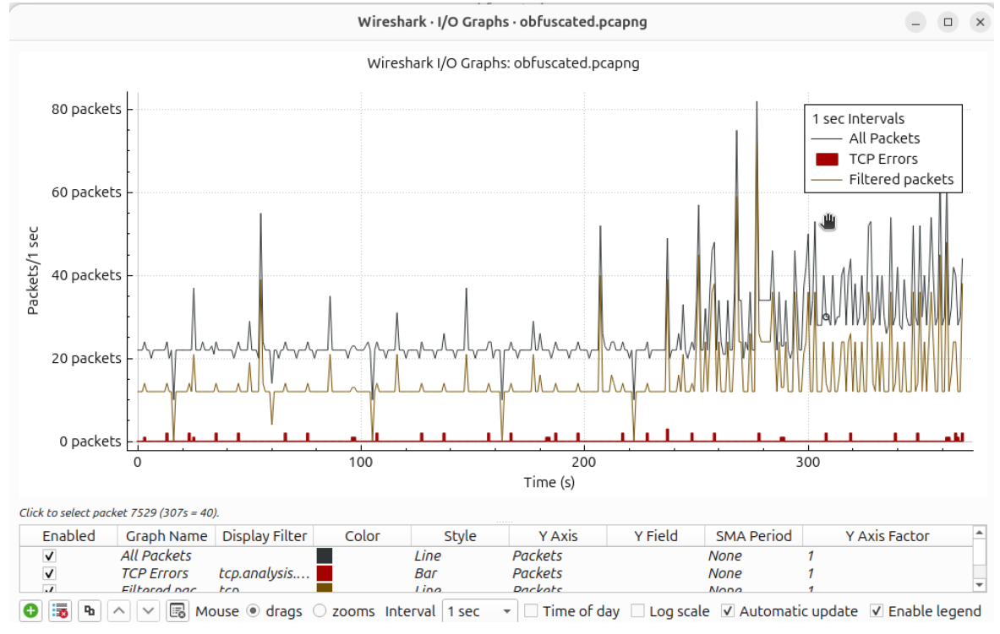

# Technical Research Report

## Network Traffic Obfuscation and Metadata Exposure in Defence-Oriented Network Security

**Independent applied network security research | Completed 2026**  
**Evidence:** Controlled virtualised experiments; Wireshark captures; Python traffic-modification workflow  
**Classification:** Public-facing adaptation of an academic research project; not an assessment of an operational defence system

## 1. Executive assessment

Encrypted communications do not eliminate network-metadata exposure. Even when content is protected, a passive observer may still inspect sizes, timing, flow characteristics and protocol structure. This investigation evaluated whether lightweight behavioural changes reduce those observable patterns.

The experiments produced baseline and modified traffic and compared them using Wireshark. The modified traces exhibited more variation in packet lengths, communications timing and flow behaviour, while the DNS, HTTP and TCP/TLS traffic continued functioning. However, recognisable protocol behaviour remained visible. The defensible outcome is **partial behavioural obfuscation**, not demonstrated evasion of a sophisticated traffic-analysis system.

**Engineering implication:** In high-assurance environments, obfuscation should be evaluated as one possible privacy-enhancing mechanism alongside traffic monitoring, network design, protocol choice and measurable performance overhead. It should not be accepted as an effective security control without realistic adversarial testing.

## 2. Research question and operating context

**Question:** To what extent can lightweight traffic-obfuscation techniques change observable communication patterns while preserving normal network functionality?

The research used a defence-oriented threat model because metadata can be especially consequential when communications reveal operational rhythms or service relationships. The environment was a **controlled laboratory simulation**, not a named or live military network. The observation model was passive: analysis relied on network metadata rather than decrypting traffic payloads.

The model considered a client, services receiving network requests, and a monitoring/observer function. In practice, packet inspection was limited to the **client virtual machine** rather than a dedicated distributed sensor or network mirror.

## 3. Experiment design

### 3.1 Baseline condition

Python-generated network communication was observed using Wireshark. The captures included web activity, DNS resolution and TCP/TLS sessions. Baseline measurements characterised packet-size bands, traffic bursts, request/response structure and timing consistency.

### 3.2 Modified condition

The original report documents three lightweight approaches:

- **Packet-size modification / padding:** introducing size variation to reduce consistent packet-length signatures.
- **Timing manipulation:** adding delays and jitter to change inter-packet intervals.
- **Dummy traffic:** injecting additional synthetic traffic at varying intervals to increase background variability.

Modified traffic was captured and compared with the baseline using the same broad analysis method. This report does not treat the displayed captures as proof that every technique was individually isolated or that a production-grade system was developed.

### 3.3 Evaluation evidence

| Category | Observation method | Question answered |
| --- | --- | --- |
| DNS | Wireshark query/response inspection | Were hostname-resolution signatures still visible? |
| HTTP | GET requests and response inspection | Did ordinary request/response behaviour continue? |
| TCP/TLS | Session, ACK and TLS record inspection | Were encrypted connections still identifiable and functional? |
| Packet sizes | Wireshark Packet Lengths statistics | Did the size-band distribution change? |
| Timing | Wireshark I/O Graphs | Did the apparent shape of network activity become less predictable? |

## 4. Observed results

### 4.1 Packet-length statistics

The two tables below are preserved directly from the original report's Wireshark appendix.

| Packet-length band | Baseline capture | Modified capture |
| --- | ---: | ---: |
| Total captured packets | 9,946 | 9,729 |
| 80–159 bytes | 9,558 (96.10%) | 4,591 (47.19%) |
| 40–79 bytes | 248 (2.49%) | 4,134 (42.49%) |
| 5,120 bytes and greater | 6 (0.06%) | 441 (4.53%) |

**Interpretation:** The distributions differ markedly. The reported evidence supports that the observed metadata profile changed; it does **not** quantify how much harder a trained classifier would find the traffic to identify. Differences in workload composition or capture duration could affect a direct comparison.

### 4.2 Timing evidence

The baseline graph displays recurring bursts separated by low-activity intervals. The modified trace displays a more uneven pattern, with more variable traffic rates. These are separate capture windows, so absolute rates and counts should not be interpreted as matched experimental endpoints without additional normalisation.

### 4.3 Protocol continuity and observability

| Protocol | What was observed | What the evidence supports |
| --- | --- | --- |
| DNS | Standard name-resolution traffic persisted after modification | Operation continued; protocol remained recognisable |
| HTTP | HTTP GET and successful response behaviour still appeared | Application-level communication continued |
| TCP/TLS | ACKs and encrypted sessions remained observable | Transport and encrypted sessions remained operational but fingerprintable |

**Interpretation:** The system changed some behavioural features without eliminating protocol signatures. This is a more conservative and defensible conclusion than stating the traffic was made anonymous.

## 5. Threat and control assessment

The original experiment examined passive metadata inspection: how an observer might infer network behaviour without decrypting payloads. It did not demonstrate a measured reduction in the accuracy of an implemented machine-learning detector. Academic work on ML traffic analysis informed the threat model, but no full classifier or statistical false-positive benchmark was built for these results.

Potential high-assurance engineering implications:

1. **Define the observable threat:** Specify what a monitoring system can see (packet timing, packet size, endpoints, flows) before choosing an obfuscation control.
2. **Validate each control independently:** Compare matched traffic scenarios with and without the intervention, ideally using identical workloads and repeated seeds.
3. **Measure both privacy and service costs:** Record throughput, bandwidth overhead, latency and reliability alongside traffic-identification outcomes.
4. **Evaluate adaptive observers:** Re-test against relevant detection approaches and include the possibility that an analyst can learn the new modified signature.
5. **Treat deployment as a new assurance step:** Validate with representative, authorised network data and realistic monitoring placement before any operational recommendation.

These are **recommendations derived from the research**, not results of additional experiments.

## 6. Constraints and uncertainty

- **Monitoring point:** Captures were taken on a client VM. This cannot replicate the visibility of a distributed defence network security monitoring system.
- **Workload realism:** Simulated sessions were relatively narrow in protocol and activity diversity.
- **Evaluation strength:** The project used behavioural packet inspection and descriptive statistics; it did not provide experimentally derived attacker accuracy, measured false-positive rates or a trained adversarial classifier.
- **Comparability:** Baseline and obfuscated captures contain different packet totals and recording windows, so visual contrast cannot alone isolate causal improvements.
- **Generalisation:** Conclusions about sophisticated defence-oriented systems are **risk-informed interpretation**, not directly tested performance of those systems.
- **Availability:** Source scripts and original PCAPs are not included in this release. Reproducing the exact experiments would require the original artifacts plus a documented test configuration.

## 7. Conclusion

The controlled experiment provides evidence that lightweight changes to communication behaviour can alter packet-length and timing characteristics while normal protocols continue functioning. The more important result is the limitation: DNS, HTTP and TCP/TLS structures still appeared after modification. This means **behavioural irregularity should not be equated with robust resistance to traffic analysis**.

For a defence-oriented security review, the responsible next step would be a controlled validation plan using representative workloads, explicit attacker models, measured classification performance, and service-impact thresholds before claiming operational risk reduction.

## 8. Research provenance and figure notes

Adapted from *Evaluating the Effectiveness of Traffic Obfuscation Techniques Against Traffic Analysis Attacks in Defence-Oriented Network Environments*, completed in 2026. Images reproduced here are crops of the packet-length and traffic I/O graphs from the original research appendix; they have not been recreated or statistically altered. Their interpretation remains subject to the study's limitations.

The original university cover page and personally identifying administrative details are intentionally omitted from this public technical presentation. The full academic document is not reproduced here. A copy of the complete bibliography should accompany any separate academic distribution of the source report.
